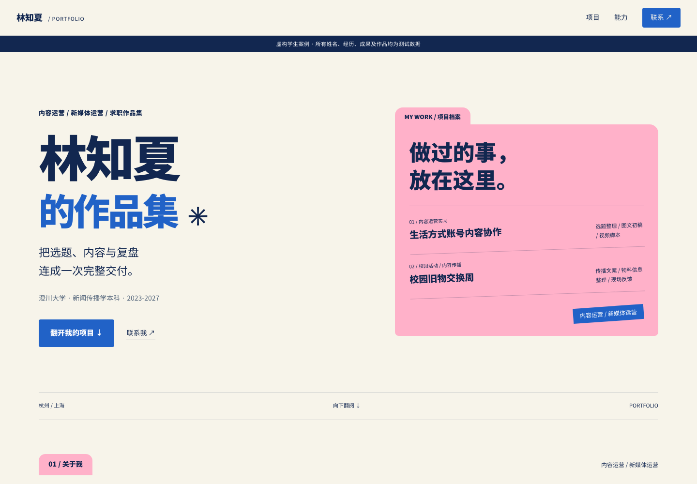

# 秋招作品集生成器 · Career Portfolio

给 Agent 一份简历，先根据真实经历追问补充材料，再生成一份 PDF 作品集和可离线打开的动态网页。

由 Mandy 制作。沿用粉、蓝、米白的文件夹设计，把实习、校园项目和课程作业整理成有内容、有图片、有具体交付的面试展示。



> 预览中的姓名、学校、经历、成果和作品均为虚构测试数据，不是真实学生案例。仓库不含学生简历或作者私人照片。

## 使用过程

1. **发送简历**：Agent 读取 PDF、Word、图片或文字简历，识别求职方向和相关经历。
2. **补充材料**：Agent 针对简历提出 2–5 个问题，询问项目截图、照片、作品链接，以及本人具体负责的部分。必须等用户真实回复；没有更多材料也能继续。
3. **生成作品集**：根据材料调整页数和版式，生成 PDF、动态 HTML 和网页发布包。没有数字就写实际产出，没有图片就采用文字版式，不编造成绩或作品。

这是一个需要 Agent 读取资料、对话和执行脚本的 Skill，不是上传到浏览器就能自动处理简历的在线服务。

## 安装与调用

下载本仓库 ZIP 并解压，将包含 `SKILL.md` 的文件夹命名为 `career-portfolio`，放入所用 Agent 支持的 Skill 目录，再刷新或重启 Agent。

Codex 可放入 `~/.codex/skills/career-portfolio/`，通过 `$career-portfolio` 调用。其他支持 `SKILL.md` 的 Agent，请按各自的安装方式加载；也可以让有文件和命令执行能力的 Agent 阅读本仓库的 `SKILL.md`，按步骤执行。

发送简历后，可以这样开始：

```text
请使用 career-portfolio Skill，把这份简历整理成求职作品集。
我准备投递内容运营岗位。请先看简历，再问我有哪些项目资料可以补充。
最终需要 PDF 和动态 HTML 网页。
```

## 输出文件

| 文件 | 用途 |
| --- | --- |
| `作品集.pdf` | 16:9 横版分页，便于发送、展示和打印 |
| `index.html` | 手机和电脑适配的动态网页，自包含字体与图片，可离线打开 |
| `website.zip` | 静态网站发布包，可交给其他 Agent 或部署服务托管 |
| `print.html` | 用于 PDF 导出和后续修改的分页源文件 |
| `build-report.json` | 本次生成结果与检查信息 |

网页包含滚动出现、横向图集、图片放大和项目内容展开等交互。关闭 JavaScript 或启用减少动态效果时，正文仍然可读。**生成网页文件后，公开网址和域名托管需要另行配置。**

## 运行环境

- Agent 需要能读简历与图片、追问并等待回复、写入文件、执行本地命令。
- 网页生成需要 **Node.js 18+**，脚本使用内置模块，无需安装 npm 依赖。
- PDF 导出需要已有 **Playwright / Puppeteer 或 Chrome / Chromium**；环境检查不会自动安装软件。
- `scripts/read-resume.py` 是可选的正文提取辅助：TXT、Markdown、DOCX 使用 Python 标准库，PDF 需要已有 `pypdf`。扫描件仍需视觉读取能力。

完整工作流程见 [SKILL.md](SKILL.md)。脚本由 Agent 在真实追问和回复之后执行，不应跳过材料环节直接调用生成器。

```sh
# 只检查 PDF 导出环境
node scripts/export-pdf.cjs --check

# 完成补料登记并生成 profile.json 后，由 Agent 执行
node scripts/build.cjs --profile "/path/to/profile.json" --workspace "/path/to/workspace" --out "/path/to/workspace/output"
node scripts/export-pdf.cjs --html "/path/to/workspace/output/print.html" --out "/path/to/workspace/output/作品集.pdf"
```

PDF 模块或浏览器未被自动找到时，可传入 `--module` 或 `--browser`，详见[运行与交付](references/runtime-and-delivery.md)。

## 内容与隐私

公开成品只包含选定的展示内容。原简历、补料问答、内部来源记录及本地文件路径不会打进网页发布包。项目图片需来自用户提供的真实材料，并确认适合展示；联系方式只使用本人愿意公开的信息。Skill 本身不会自动上传简历，也不会自动发布学生网页。

## 文件说明

```text
SKILL.md                       Agent 工作流程
agents/openai.yaml             Codex 展示与调用配置
references/                    补料原则、内容结构和运行说明
scripts/intake.cjs             简历登记、问题与回复状态
scripts/read-resume.py         可选的正文提取辅助
scripts/build.cjs              HTML 与公开发布包生成
scripts/export-pdf.cjs         PDF 环境检查与导出
scripts/zip.cjs                ZIP 打包辅助
assets/                        网页、打印样式与交互脚本
assets/fonts/                  离线中文字体及其许可说明
docs/                          虚构测试案例的效果预览
```

## 已验证范围

v0.1.0 已在 macOS、Node.js 24、Chromium 环境中验证：充分材料样例为 7 页 PDF，精简材料样例为 3 页；检查了手机 390px 与电脑 1440px、离线显示、图集放大、无 JavaScript / 减少动态效果、PDF 分页与文字检索，以及解压后的独立运行。尚未在 Windows、Linux 或小红书使用端实测。

字体基于 Noto Sans SC，随包保留 [Apache 2.0 许可证](assets/fonts/LICENSE-APACHE-2.0.txt)及[字体修改说明](assets/fonts/NOTICE.txt)。字体许可仅适用于相应字体文件。
